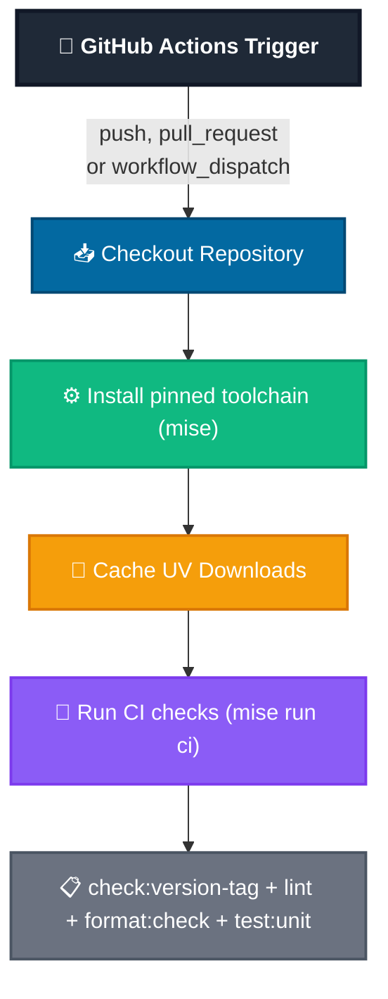

# CI Flow (GitHub Actions)

This document shows the CI flow used in `.github/workflows/test.yml`.

## Workflow Summary

Triggers on push/PR to `main` plus `workflow_dispatch`; single Ubuntu job runs `mise run ci`.

- **Pinned toolchain**: `mise.toml` via `jdx/mise-action`, the same gate `AGENTS.md` requires locally.
- **Bash skips inline**: multiline shell steps open with `#!/usr/bin/env bash` and `set -euo pipefail`, and guard with `[[ -d ]]`; no separate bash version-floor task.
- **Single job, no matrix**: rendering is platform-independent.
- **No prek in CI**: hooks run locally (`mise run hooks:run`); CI uses check-only `lint` and `format:check`.
