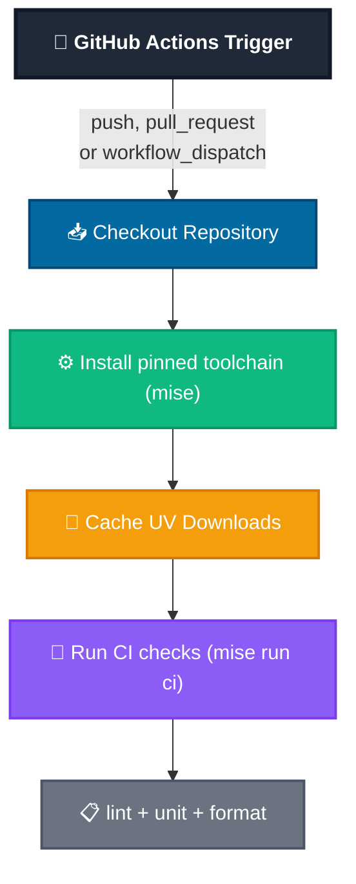

# CI Flow (GitHub Actions)

This document shows the CI flow used in `.github/workflows/test.yml`.

## Workflow Summary

The CI pipeline triggers on every push and pull request to `main` (plus manual
`workflow_dispatch` runs) and validates the template in a single Ubuntu job.
Key features:

- **Pinned toolchain**: Python, `uv`, and `shellcheck` versions come from
  `mise.toml` via `jdx/mise-action`, so CI uses exactly the toolchain pinned
  for local development (`mise run ci` is the same gate as `AGENTS.md` requires
  before pushing).
- **Single job, no matrix**: one OS, one Python (the mise pin) — the old
  10-job grid (2 OS × 5 Pythons) multiplied Copier-render cost for no signal,
  since rendering is platform-independent Python and the interpreter is pinned.
- **Dependency caching**: uv download caches are cached for faster runs.
- **Test execution**: `mise run ci` runs `lint` + `unit` + `format`, where
  `unit` is the Copier template validation suite in `my_tests/`.

## Key Stages

| Stage | Purpose |
|-------|---------|
| 🚀 Trigger | Initiates workflow on code changes |
| 📥 Checkout | Retrieves repository code |
| ⚙️ Setup | Installs pinned toolchain via mise |
| 💾 Cache | Optimizes dependency installation |
| 🧪 Tests | Executes `mise run ci` (lint + unit + format) |
